> **For rendering first.** Lens Tracing traces the light of every pixel through the lens's glass, which costs much more GPU time than Unreal's own depth of field. For now it is meant for rendering, such as cinematics and stills, more than for games that must hold their frame rate. It will be optimized over time: the [roadmap](Lens-Tracing-Reference#roadmap), in the Reference page, lists the speed work planned.

## How this tutorial goes

With Lens Tracing you don't dial in a blur: you mount a lens and set the camera, and the lens's own glass shapes the bokeh, the dark corners, the distortion and the swirl, as on set. The tutorial follows a shoot, from the first frame to a lens you make yourself:

1. [**Your first shot**](#part-1-your-first-shot): place the camera, check its lens, focus.
2. [**The camera body**](#part-2-the-camera-body): choose the sensor format.
3. [**Exposure**](#part-3-exposure): the camera's own shutter speed and ISO, and grain.
4. [**Focus and bokeh**](#part-4-focus-and-bokeh): where focus is measured from, and the iris.
5. [**The lens kit**](#part-5-the-lens-kit): what each lens brings to the image, and how to tame it.
6. [**Shooting a sequence**](#part-6-shooting-a-sequence): focus pulls, iris pulls and zooms in Sequencer.
7. [**Your own lens**](#part-7-your-own-lens): change a lens, build one, or import a real one from Optical Bench.

Every setting and console variable, and the roadmap, are in the [Reference](Lens-Tracing-Reference).

## Part 1: Your first shot

Four steps give you a frame through a real 50 mm f/1.4. The lenses and the **Demo** level, where the pictures were taken, are in **Plugins > UTC Lens Tracing Content** (in the Content Browser, **Settings > Show Plugin Content**).

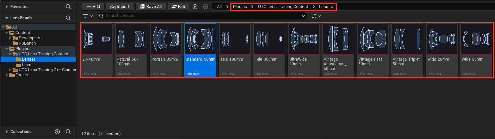

1. **Place a Lens Tracing Cine Camera Actor** (**Quick Add**, type *Lens Tracing*). It is a Cine Camera Actor: Sequencer and Blueprints use it as one.

   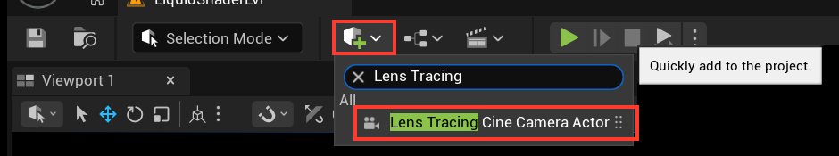

2. **Check the lens.** A new camera comes with **Standard_50mm**, a 50 mm f/1.4, mounted: it is in **Lens Tracing > Lens > Lens Data**, in its Details. To mount another lens, pick it in that slot.

   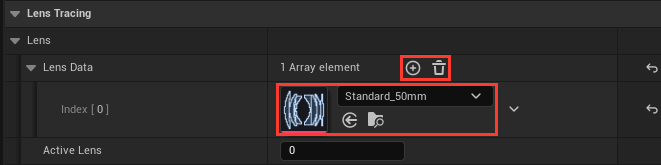

3. **Look through it.** Only views through a lens tracing camera are traced: your other cameras and viewports render as before.
4. **Focus.** **Manual Focus Distance** and its eyedropper are in **Lens Tracing > Focus**. A new camera is focused at 1 km.

What you are looking at is the 50 mm's own rendering, not a generic blur:

- **The background melts into its bokeh**: round in the middle, cat's eyes towards the corners.
- **The corners darken a little**, as on a fast lens wide open.
- **Straight lines bow out slightly** near the edges: the lens's own barrel distortion.
- **The framing tightens a little as you focus closer**: the lens breathes.

Part 5 shows what each lens brings, and the switch that turns each trait off. To compare with Unreal's ideal lens, set **Active Lens** to 1: no lens sits in that slot, so the camera renders as a plain Cine Camera. Set it back to 0 to mount the lens again.

## Part 2: The camera body

The format is set in **Lens Tracing > Sensor > Filmback**, as on any Cine Camera: a preset, or your own size in mm. Two things are new.

- **The default sensor crops the kit.** Unreal starts on a Super 35 sensor, and the kit's lenses are full-frame designs, so they frame 1.5 times tighter on it. Pick **16:9 DSLR** for full frame in 16:9.
- **The lens can choose.** Tick **Recommended Sensor**, inside **Filmback**: the camera takes the largest format the mounted lens covers, and follows every lens you mount.

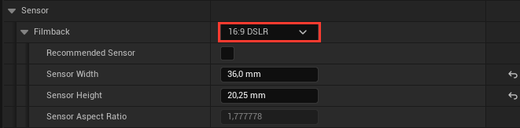

A lens covers its image circle and no more: on a larger sensor the corners go black, as with a crop lens on a full-frame body. All the kit's primes cover full frame.

## Part 3: Exposure

The camera has its own **Shutter Speed** and **ISO**, with **Auto ISO**, next to **Current Aperture** in **Lens Tracing > Exposure**. Out of the box it works like manual mode with Auto ISO: Unreal's automatic exposure sets the brightness, so aperture and shutter are free for their look.

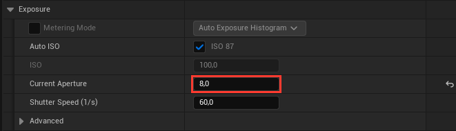

**Shutter Speed** is in 1/s: 60 means 1/60 s, and a 180° shutter at 24 fps is 48. It sets the grain, the motion blur (Part 6), and in Manual metering the brightness.

**Auto ISO**, ticked by default, shows the ISO the automatic exposure amounts to, next to the box, while you look through the camera. Untick it to set your own ISO for the grain.

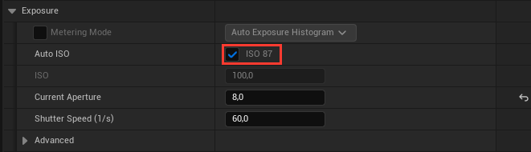

**Manual metering** (**Metering Mode** set to **Manual**): ISO, aperture and shutter set the brightness, as on your camera. Light the scene with real-world values and sunny 16 works under a 100 000 lux sun. **Current Aperture** is an f-stop, not a T-stop: the glass loses no light.

**Grain.** Tick **Sensor > Noise > Sensor Noise** for the noise of a real sensor, a 24-megapixel full-frame CMOS by default. Less light on the sensor, from a smaller stop, a faster shutter or a darker scene, means more grain at the ISO in use. It needs real-world light values: in a scene lit with small values, Auto ISO climbs high and the image turns very grainy.

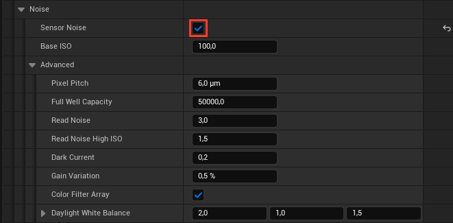

## Part 4: Focus and bokeh

**Focus** works as on any Cine Camera, with one difference: distances are measured from the lens's entrance pupil, where the camera actor sits, not from the sensor mark. It matters close up, and the camera pans and tilts around that no-parallax point.

**Bokeh** comes from the lens and its iris. Wide open the iris is out of the way: the bokeh is round, and the cat's eyes towards the corners come from the glass. Stop down and the blades show, rounded polygons that straighten as you close. The blades change the shape only: the exposure follows the f-stop.

1. **Choose the blades:** **Diaphragm Blade Count**, in **Lens Tracing > Iris**, 4 to 16.

   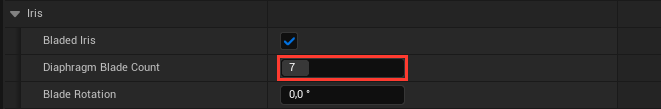

2. **Stop down** past the lens's widest stop.

   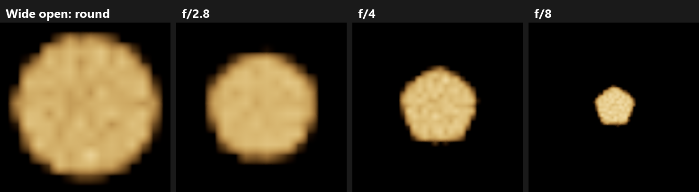

3. **Turn the iris:** **Blade Rotation**, in degrees. At 0, background bokeh sit on a flat edge; foreground bokeh are upside down, as with a real lens.

   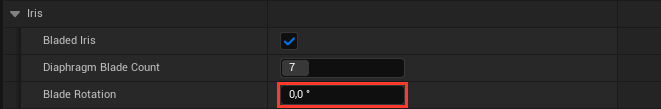

Untick **Bladed Iris** for a round iris at every stop.

## Part 5: The lens kit

The kit holds ten primes and two zooms, each a real optical design with its own drawing: you pick one for its angle of view and its character, as from a lens case.

The primes come from expired patents, scaled to their focal length: the designer's curvatures, spacings and glass, with the iris position and element sizes worked out where the patent left them out. All of them cover full frame.

| Lens | Design | Widest stop | What you will see |
| --- | --- | --- | --- |
| UltraWide_20mm | Retrofocus, Nikon patent, 1984 | f/2.8 | Strong barrel with a wave near the edges, dark corners wide open |
| Wide_28mm | Retrofocus, Olympus patent, 1975 | f/2.8 | Moderate barrel, darker corners wide open |
| Wide_35mm | Retrofocus, Nikon patent, 1988 | f/2 | Moderate barrel, cat's eyes in the corners at f/2 |
| Standard_50mm | Double Gauss, Nikon patent, 1981 | f/1.4 | The everyday fast fifty: gentle barrel, cat's eyes towards the corners wide open |
| Portrait_85mm | Medium telephoto, Asahi (Pentax) patent, 1983 | f/1.4 | Almost no distortion, big smooth bokeh, cat's eyes at the edges wide open |
| Tele_180mm | Telephoto, Nikon patent, 1979 | f/2.8 | Slight pincushion, even corners, flattened perspective |
| Tele_300mm | Telephoto with a fluorite element, Canon patent, 1975 | f/4 | Slight pincushion, very even corners |
| Vintage_Fast_50mm | Ludwig Bertele's fast 50 for Zeiss Ikon, 1932 | f/1.5 | Pincushion, strong darkening towards the corners, stretched bokeh at the edges |
| Vintage_Anastigmat_50mm | Paul Rudolph's anastigmat for Zeiss, 1902 | f/5.5 | Slow; a curved field: the corners focus nearer than the centre |
| Vintage_Triplet_50mm | H. Dennis Taylor's triplet, 1896 | f/5.6 | Slow; dark, soft corners on full frame |
| 24-48mm | Two-group wide zoom, Canon patent, 1979 | f/3.5 to f/5.0 | Barrel at 24 mm, slight pincushion at 47 mm |
| Petzval_50-100mm | A Petzval zoom designed for the plugin | f/2.4 to f/3.3 | Swirl at every focal length; covers 16:9 DSLR, dark corners on 36 × 24 beyond about 80 mm |

**The lens sets the focal length.** **Current Focal Length**, in **Current Camera Settings**, greys out: it shows the framing focal length, breathing included. Every lens focuses by moving as a whole, as classic primes do, so they all breathe: Standard_50mm frames like a 51 mm at 2 m.

**Carry a kit.** Add more slots to **Lens Data**; **Active Lens** says which one is mounted, counting from 0. To look at a lens before mounting it, double-click it in the Content Browser: the Lens Editor renders a test scene through it (Part 7).

**Zooms.** Mount **24-48mm** or **Petzval_50-100mm** and a **Zoom Focal Length** row appears in **Lens Tracing > Focus**: set the focal length within the lens's range. The angle of view, distortion, vignetting and widest stop change as on the real lens. Like a kit zoom, the 24-48mm opens to f/3.5 at 24 mm but only f/5.0 at 47 mm: set wider, it stays at its widest, and in Manual metering the image darkens as you zoom in. Focus holds while you zoom.

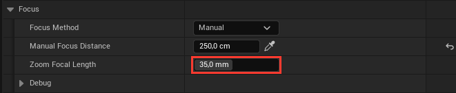

**Tame the lens.** **Lens Tracing > Lens Effects** has one switch per optical trait, per camera, like a lens profile you turn on or off. All are ticked on a new camera. An unticked effect is never rendered, not corrected afterwards.

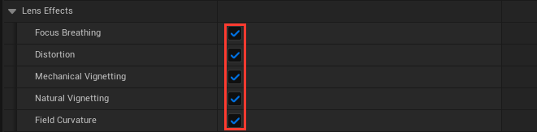

| Switch | Unticked, you get |
| --- | --- |
| Focus Breathing | A framing that ignores focus, like a cine lens corrected for breathing |
| Distortion | Straight lines, as after a lens profile correction |
| Mechanical Vignetting | No cat's eyes and no glass-edge darkening: only the iris limits the light |
| Natural Vignetting | Even brightness out to the corners |
| Field Curvature | One flat plane of focus: no swirl |

**Colour fringes** (chromatic aberration) are off for now while they are being optimized. To see them, type `r.LensTracer.ChromaticAberration 1` in the console: blurred edges and highlights take colour fringes and the colours part towards the corners, as the lens's Abbe Numbers say, on every camera and in the Lens Editor's preview. The lens then renders about 2.5 times slower; `r.LensTracer.ChromaticAberration 0` turns them off again.

## Part 6: Shooting a sequence

The plugin's settings key in Sequencer like the Cine Camera's own:

- **Active Lens** changes lens on the frame, like a cut.
- **Zoom Focal Length** zooms.
- **Current Aperture** pulls the iris. With Auto ISO the brightness holds while the depth of field changes; in Manual metering each stop changes the brightness.
- **Shutter Speed**, **ISO**, **Blade Rotation** and the **Lens Effects** switches key too.

In Blueprints, the same settings have **Set** nodes (Set Active Lens, Set Zoom Focal Length…).

**Rendering.** **Movie Render Queue**, a **High Resolution Screenshot** through the camera and packaged games render through the lens, at any screen percentage. For its distortion the lens renders a small margin beyond the frame, which Movie Render Queue crops; three of its settings matter:

- **Output Resolution:** use your sensor's aspect ratio, for instance 1620 × 1080 for a 3:2 sensor. Letterboxed in another ratio, the frame keeps the margin: about 2 % wider, with smeared edges. Keep one sensor shape per render: **Recommended Sensor** can change it with the lens.
- **High Resolution** tiles: set **Camera > Overscan Percentage Override** to 10 %, or some frames come out larger and uncropped.
- **Temporal Sample Count** above 1: change lens on a camera cut. On the frame where **Active Lens** changes, the samples mix both lenses.

The samples also average the **Sensor Noise**: with 8 of them it comes out several times weaker than in the viewport. They smooth edges but not the bokeh's grain: for that, raise the lens's **Max Rays Per Pixel**.

**Motion blur** is off for now while it is being optimized, and Unreal's own motion blur stays off on the lens camera. To try the lens tracer's own, type `r.LensTracer.MotionBlur 1` in the console: it shows in Play and in Game View (**G**), its length set by **Shutter Speed**, and out-of-focus lights streak with their bokeh shape.

## Part 7: Your own lens

A lens is a **Lens Data** asset: its glass surfaces in order from the front, as a lens patent lists them. The easiest way in is to change a kit lens; then build one, or import a real lens from Optical Bench.

Every lens is written this way, however many elements it has: one row per surface, read from the front.

### The Lens Editor

The Lens Data asset:

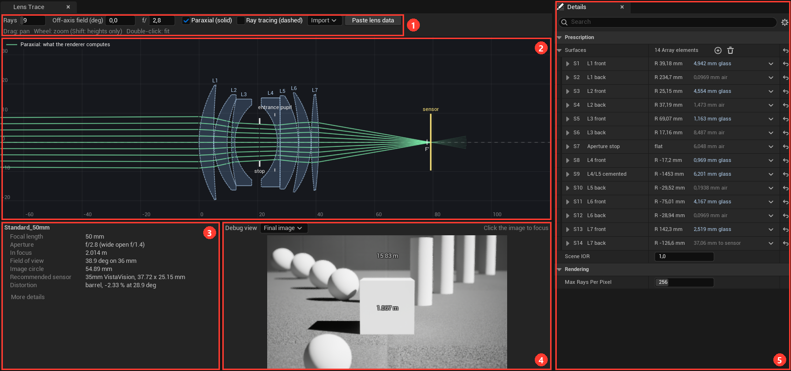

1. **Toolbar.** What the drawing and the preview show: rays, an off-axis angle, the zoom and the preview's f-stop (none of them saved), then the import buttons.
2. **Drawing.** The lens in cross-section, light from the left: elements **L1**, **L2**…, the **stop** (the iris), the entrance pupil and the sensor. A red cross marks a blocked ray. Hover a surface in the Details and the drawing outlines it.
3. **Summary.** What you choose a lens by: focal length, widest stop, distance in focus, field of view, image circle, recommended sensor and distortion. Warnings show in orange at the top; **More details** adds the numbers a lens designer reads.
4. **Preview.** A test scene rendered through the lens; click it to focus. **Debug view** swaps the final image for the **Blur radius**, the **Image circle** or the **Vignetting**.
5. **Details.** The surfaces, then two lens-wide settings: **Scene IOR** (1 in air, 1.33 for a lens in water) and **Max Rays Per Pixel** (256: fewer renders faster, more gives smoother bokeh).

### What the rows do

Each row of **Surfaces** is one surface, **S1** nearest the scene, named as in the drawing: **L1 front**, **L1 back**, **L4/L5 cemented**, **Aperture stop**. An element takes two rows: the front one carries the glass, the back one the air after it. Open a row to edit it.

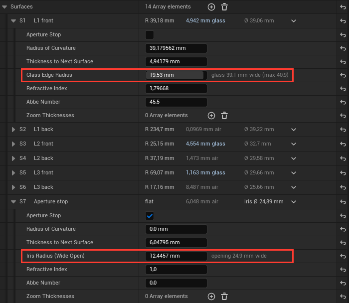

| Row | What it is | What it does to the image |
| --- | --- | --- |
| Radius of Curvature | How curved the surface is, mm. Positive bulges towards the scene, negative towards the sensor, 0 is flat | Together, the curves set the focal length, the distortion and how the field curves |
| Thickness to Next Surface | The glass or the air after the surface, mm; on the last surface, the distance to the sensor | Spacing the elements changes the focal length; the last one places the sensor |
| Refractive Index | How strongly the glass after the surface bends light: 1 for air, 1.5 to 1.9 for glass | Denser glass gives the same power with gentler curves |
| Abbe Number | How much that glass splits colours: about 64 for a crown glass, 25 to 40 for a flint | Lower splits more: stronger colour fringes |
| Glass Edge Radius | Half the glass's diameter, mm | Smaller: stronger cat's eyes and darker corners |
| Aperture Stop | This surface is the iris | Where the iris sits shapes the cat's eyes and the vignetting |
| Iris Radius (Wide Open) | The Glass Edge Radius of the stop: how wide the iris opens, mm | Sets the widest f-stop |
| Zoom Thicknesses | Zoom lenses: this gap at each zoom position, wide to tele | Moves the groups as you zoom |

### Change a kit lens

1. **Copy a kit lens into your project** and open the copy: the kit's own lenses stay as they are.
2. **Darker corners, stronger cat's eyes:** lower the **Glass Edge Radius** of the front or the rear element a little at a time, and watch the preview or its **Vignetting** view. If an orange warning says axial rays never reach the sensor, the edge now cuts the middle of the beam too: the lens got slower.
3. **A faster or slower lens:** change the stop's **Iris Radius (Wide Open)**; the summary gives the new widest stop. Open it past what the glass lets through and the same warning appears.
4. **More colour fringes:** lower an **Abbe Number**. The fringes show once `r.LensTracer.ChromaticAberration 1` is typed in the console, in the preview and on every camera.
5. **Mount it** in a camera's **Lens Data**.

### Build one from scratch

1. **Create it:** in the Content Browser, right-click > **Lens Data**, under Miscellaneous. A new lens starts as an iris in front of one glass element: 50 mm at f/2.8, sharp in the middle and soft towards the edges, like any single lens.

   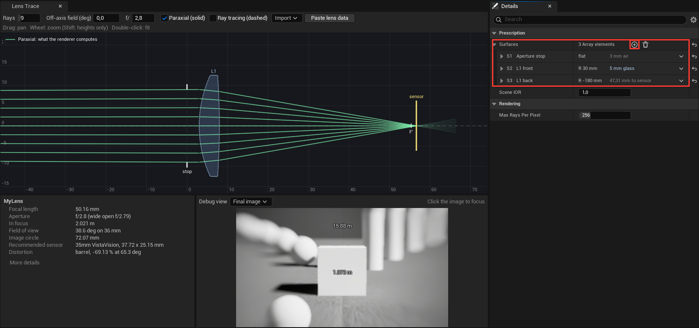

2. **Add elements:** the **+** next to **Surfaces** adds a whole glass element behind the last one, and moves the sensor so the lens stays in focus. **Insert**, in a row's menu, adds a single flat surface in air: for a cemented pair, or a new place for the iris.
3. **Shape them:** radii, thicknesses and glass, row by row. Take the glass from a catalogue: N-BK7, a common crown, has an index of 1.5168 and an Abbe number of 64.17.
4. **Place the iris:** tick **Aperture Stop** on its surface and set **Iris Radius (Wide Open)**.
5. **Size the glass:** a **Glass Edge Radius** per surface. The editor won't let a glass get wider than its curves allow.
6. **Check it:** the green rays meet on the sensor with no red cross on the axis, and no warning shows. The summary gives the focal length, the widest stop and the image circle.

### Import a lens from Optical Bench

[Optical Bench](https://photonstophotos.net/GeneralTopics/Lenses/OpticalBench/OpticalBenchHub.htm), William J. Claff's site, holds the prescriptions of more than 1,285 known lenses, taken from their patents: the lens on your shelf may be there. The plugin downloads nothing itself: you open the data in your browser and paste them.

1. **Make a Lens Data asset** for the lens (Content Browser, right-click > **Lens Data**), name it after the lens and open it.
2. **Open the list.** Click **Import > Optical Bench** in the Lens Editor's toolbar: Optical Bench's table of lenses opens in your web browser. Click a column header to sort it, or search the page (Ctrl+F) for the maker or the focal length.

   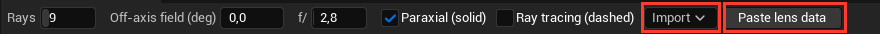

3. **Open the lens.** Click it in the table: its Optical Bench page opens in a new tab.
4. **Paste the page's address.** Copy the address from the browser (Ctrl+L, Ctrl+C) and click **Paste lens data** in the Lens Editor: the plugin opens the lens's data file in your browser.
5. **Paste the data.** In that tab, select all (Ctrl+A) and copy (Ctrl+C), then click **Paste lens data** again. The surfaces are replaced (Ctrl+Z undoes it), the drawing and the preview show the new lens, and a message gives its name and what to know about it.
6. **Check and mount it.** The summary gives its focal length and widest stop; add the asset to a camera's **Lens Data**.

| Message | Meaning |
| --- | --- |
| Zoom with 3 positions | A zoom: turn it with **Zoom Focal Length** |
| Back focus … computed from the surfaces | The file's back focus disagrees with its surfaces: the sensor goes where the surfaces focus |
| Aspheric in the file: S4, S26 | Aspheres on the real lens, spheres here: distortion and sharpness differ from the real one |
| close-focus position left out | The real lens focuses internally; here the whole lens moves, so it breathes differently |
| Iris kept at … mm | The file changes the iris along the zoom: the first one is kept |
| No clear diameter on S3 | The file gives no glass edge there: those surfaces cause no vignetting |

**Import > From .dat file** reads a saved Optical Bench file or a PBRT lens file, and **Paste lens data** also takes a PBRT table. The kit's lenses are in that format in the plugin's `Docs/Lenses` folder, with their sources.

### Make a zoom

A zoom is a Lens Data whose moving gaps have **Zoom Thicknesses**: one value per zoom position, wide to tele, on every gap that moves, the last surface included when the back focus moves. **Zoom (mm)** then appears in the toolbar, and the summary gives the range. Between two positions the gaps change in straight lines.

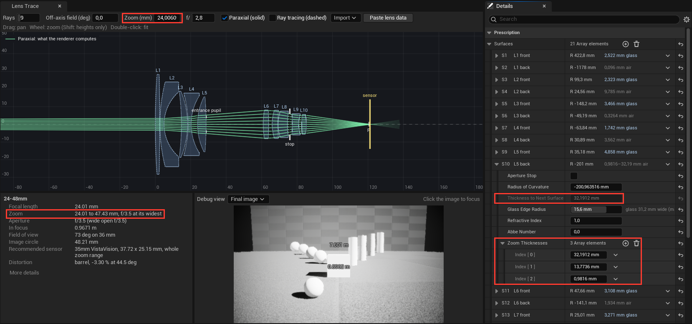

### When the editor warns

| Warning | Fix |
| --- | --- |
| … axial rays never reach the sensor … stops at S5 | A glass edge cuts the middle of the beam: widen that Glass Edge Radius, or close the iris |
| S3 glass edge radius …, but … limits it to … | The glass can't be that wide with these curves: lower its Glass Edge Radius |
| Negative thickness, or its surfaces cross | Two surfaces overlap: fix a Thickness or a radius |
| 2 surfaces flagged as the stop | Keep one Aperture Stop |
| Focus distance … cannot be focused | The sensor would sit inside the lens: focus farther, or check the last Thickness |
| No entrance pupil, or the sensor is on a pupil plane | The lens forms no image: check the stop and the radii around it |

## Quick answers

Most surprises come from not looking through the lens tracing camera: check that first.

| Problem | Fix |
| --- | --- |
| No lens effect | Look through the lens tracing camera, and check that **Lens Data** has a lens and **Active Lens** points to it (0 is the first slot). |
| Everything is soft | A new camera is focused at 1 km: use the eyedropper on your subject. |
| Black or dark corners | The sensor is larger than the lens's image circle: tick **Recommended Sensor**, choose a smaller format, or change lens. |
| The framing is tighter than expected | Unreal's default sensor is Super 35: pick **16:9 DSLR** for full frame. |
| Shutter Speed or ISO doesn't change the brightness | That is Auto ISO at work: set **Metering Mode** to **Manual**. Still nothing: **Exposure > Advanced > Exposure Method** must be **Enabled**. |
| The lens camera is a stop darker than Unreal's own | Its **Exposure Compensation** starts at 0, where Unreal's cameras add a stop. |
| The aperture won't open further | That is the lens's widest stop. On a zoom it changes with the focal length. |
| Bokeh stay round when I stop down | Check **Bladed Iris** and **Diaphragm Blade Count**. At the lens's widest stop, bokeh are always round. |
| Grainy bokeh | Render grain, not sensor noise: raise the lens's **Max Rays Per Pixel**, or type `r.LensTracer.SampleDensity 2` in the console. Both render slower. |
| The whole image is grainy | **Sensor Noise** is ticked in a scene lit with small values: untick it, or light with real-world values. |
| The viewport is slow | Type `r.LensTracer.SampleDensity 0.5` while you work, and 1 for final frames. Colour fringes (`r.LensTracer.ChromaticAberration 1`) alone make the lens about 2.5 times slower. |
| Glass, water or smoke is never in focus | The lens reads the depth of opaque surfaces only: tick **Output Depth and Velocity** in their material. |
| A soft halo around a sharp object in front of a very soft background | A known limit: stop down a little. |
| No lens flare | Reflections between the elements aren't traced yet, and Unreal's bloom, flares and vignette start off on the lens camera. Turn them back on in its **Post Process** if you want them. |
| A lens effect stays off although it is ticked | A console variable turns it off for every camera: type `r.LensTracer.Distortion 1`, or the same with `FieldCurvature`, `Rims` (Mechanical Vignetting), `Blades` (Bladed Iris) or `NaturalVignetting`. |
| An imported lens differs from the real one | Aspheres become spheres, and every lens focuses by moving as a whole: the import message says which applies. |
| A lens I made looks wrong | Open it in the Lens Editor: the warnings and the red crosses say where. |
