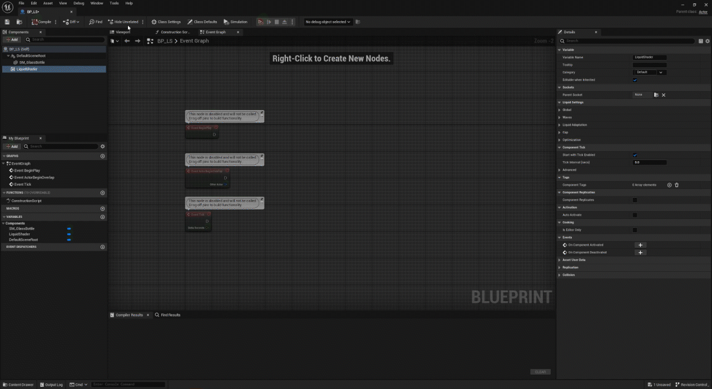
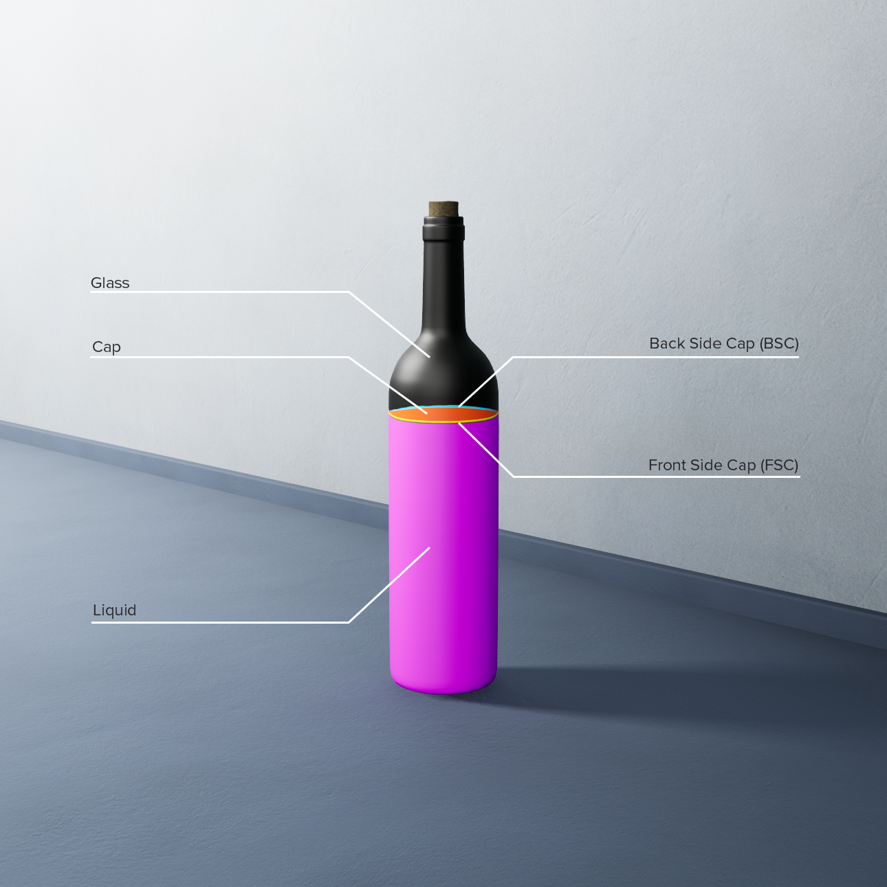

# Prerequisites

Before using the liquid shader in Unreal Engine, there are some important points you need to consider:

* The liquid shader works with a Static Mesh Actor, or with a Static Mesh Component inside a Blueprint.
* The mesh that receives the liquid shader needs to be closed.
* Make sure your mesh's normals point in the correct direction.
* The liquid adaptation measures the volume with the mesh's collision: keep query collision enabled on the mesh, and leave `Double Sided Geometry` unticked in its collision settings.

In Unreal:

* Install UTC Liquid Shader Pro from Fab to Unreal Engine 5.8.
* In Unreal Engine, go to `Edit -> Plugins` in the top-left menu of the main editor window and enable the UTC Liquid Shader Pro plugin.
* Go to `Edit -> Project Settings` in the top-left menu of the main editor window, search for `Substrate materials`, and enable it.
* Restart the editor.

The plugin's content is in the Content Browser under `Plugins -> UTC Liquid Shader Pro Content` (enable `Settings -> Show Plugin Content`). The `LiquidShader` level, in its `Map` folder, shows a bottle that is already set up.

**Coming from the free version:** remove the `UTC_LiquidShader` folder from your project's `Plugins` folder before enabling Pro. Pro keeps the free version's class names and redirects its content, so the liquids you set up with it load with Pro.

# Setting up the Actor Component

## For a Static Mesh Actor

Select the Static Mesh Actor you want to add the liquid shader to. In the Details panel, add the `Liquid Shader` component:

The material slot of the liquid must use the component's **Liquid Material Instance** (`MI_Liquid` by default).

## For a Static Mesh Component in a BP

You can find an already set-up BP at `Plugins -> UTC Liquid Shader Pro Content -> BP -> BP_LiquidActor`.

Otherwise, create your BP as usual. Add your `Static Mesh` and the `Liquid Shader` component to the BP.

That's all: the component uses the Static Mesh Component whose material slots use its **Liquid Material Instance**. The interface setup of the free version is no longer needed.

If the component finds no mesh, the liquid stays off and the Output Log says why (search for `LogLiquidShader`).

### Choosing the mesh with the interface (optional)

If several meshes of the BP use the liquid material, choose the one that holds the liquid with the `UTC LSInterface`.

Open the `Class Settings` panel from the BP toolbar. In the Details panel on the right, under the `Interfaces` section, add the `UTC LSInterface` to `Implemented Interfaces`.

In the `My Blueprint` panel on the left, under the `INTERFACES -> Liquid Shader` category, double-click `Provide Liquid Mesh Component` and connect your `Static Mesh Component` to the `Return Value` pin of its return node.

The free version's way, the `Request Static Mesh Component` event calling `Set LS Static Mesh Component`, still works.

# Actor Component Parameters

The component's settings are in its Details panel, under `Liquid Settings`.

## Global

* **Liquid Material Instance:** Set your main liquid shader Material Instance here. A default instance is already set up and can be found at `Plugins -> UTC Liquid Shader Pro Content -> Library -> MI -> MI_Liquid`. (It must be the same instance as the one assigned to the mesh: every slot that uses it gets the liquid.)
* **Include Materials:** Sometimes you may need to include other materials to close the mesh. For example, with the bottle, the cork closes the mesh but is not a liquid shader instance. Add the cork material to this list. A label that replaces part of the container's wall goes here too.

## Waves

* **Waves Intensity:** The main parameter for adjusting wave sensitivity. It is recommended to keep it at 1.
* **Waves Rotation Sensitivity:** Adjusts wave sensitivity during rotation. Adjust this parameter rather than the first one.
* **Waves Offset Sensitivity:** Adjusts wave sensitivity during translation. Adjust this parameter rather than the first one.
* **Viscosity:** Controls the wave speed.

The two Sensitivity rows are greyed out while **Sloshing** is on.

### Sloshing

New in Pro, and on by default: the liquid surface tilts against the container's acceleration and swings back like a damped spring, at the natural frequency of the liquid in that container, with the waves on top. Only changes of speed make it slosh: a container moving at a steady speed stays level. It follows the container however it moves: physics, animation, Sequencer, or attached to another actor.

* **Sloshing:** Turns the sloshing on. Off, you get the waves of the free version on a level surface.
* **Slosh Frequency Scale:** Multiplies the slosh frequency found from the container's size and the liquid's depth. 1 is physical.
* **Slosh Damping:** How fast the swinging dies out: about 0.01 for water, 0.05 for oil, 0.3 and more for syrup. From 1, the surface no longer swings back.
* **Slosh Intensity:** Multiplies the tilt caused by the movement. 1 is physical.
* **Max Slosh Angle:** The largest tilt of the surface, in degrees. The surface also stays under the top of the container.

### Advanced

* **Waves Render Target Material:** The material that draws the waves (`MM_RTWaves`).
* **Waves Resolution:** The size of the square waves render target, 128 by default.

## Liquid Adaptation

* **Show Voxel:** Use this to debug the voxel size (high performance cost).
* **Voxel Factor:** Controls the voxel size: the mesh's height is split into this many voxels. Higher is more precise.
* **Exclude Materials:** Materials of geometry modeled inside the liquid on the same mesh, such as a submerged object or a straw, whose faces would otherwise end the liquid early.
* **Adaptation Speed Scale:** A higher value hides the liquid's adaptation and removes the compression effect but can cause stuttering during slow rotations. This speed is relative to the wave sensitivity parameters, so remember to adjust it if you modify those. It is only used while Sloshing is off: with Sloshing on, the level keeps the liquid's volume exactly.

These are greyed out while **Liquid Adaptation** (under Optimization) is off.

## Cap

* **Cap Resolution:** Under Advanced, the size of the square cap and distance field render targets, 512 by default. Greyed out while Generate Cap is off.

## Optimization

* **Generate Cap:** Enables/disables the cap.
* **Clean Up Cap:** Enables/disables the clean-up pass for the cap. Greyed out while Generate Cap is off.
* **Liquid Adaptation:** Enables/disables liquid adaptation. If your object is uniform with a centered pivot point (for example, a sphere), you can disable it.

If the material's `Liquid - Offset` puts the liquid outside the mesh, the component turns Generate Cap and Liquid Adaptation off.

# Blueprint Functions

New in Pro. The component's functions are in the `Liquid Shader` category:

| Function | What it does |
| --- | --- |
| Set Liquid Offset, Get Liquid Offset | Set or read the liquid level, in the units of the material's `Liquid - Offset`. The volume is measured again from the new level: use it to fill or drain the container. |
| Add Slosh Impulse | Shakes the liquid as if the container had suddenly changed speed by `Velocity Change` (world space, cm/s), for a hit or a bump. |
| Reset Sloshing | Puts the surface back at rest, for example after teleporting the container. |
| Get Slosh Angle | The current tilt of the surface, in degrees. |
| Get Slosh Amplitude | The tilt the surface swings to, in degrees. It stays up through the swings, for example to drive a sloshing sound. |
| Get Liquid Surface Normal | The world-space normal of the liquid surface. |
| Set Sloshing, Set Generate Cap, Set Liquid Adaptation | Turn these settings on or off while the game runs. |
| Reinitialize Liquid | Runs the setup again, for example after changing the mesh's materials or the liquid material while the game runs. A new static mesh is picked up on its own. |
| Get Liquid Material Instance, Get Liquid Mesh Component, Is Liquid Initialized | The dynamic liquid material, the mesh that renders the liquid, and whether the setup is done. |

# Shader Parameters

These are the names of the different parts of the shader mask:

## Glass Shader

You can find an already set-up glass instance at `Plugins -> UTC Liquid Shader Pro Content -> Library -> MI -> MI_Glass`.

There are the usual parameters to adjust the color, specularity, normal, and roughness, to add details, and to modify the refraction. Note that the _Start Refraction Offset_ parameter is useful to remove internal refraction (for example, in the case of a cork), but it can be affected by other objects in the scene and needs improvement.

Two parameters are new in Pro:

* **Glass - Thickness:** Under the _00 - Glass_ group, the glass wall's thickness in cm. _Glass - MFP Color_ is the color the glass lets through at this thickness.
* **Glass - Edge Screen Clamp Budget:** Under the _00 - Glass - Refraction_ group, this removes the seam the refraction leaves when a bottle touches the side of the screen. It is the share of the distance to the screen edge one surface may use, from 0 to 1: lower it if a seam remains where several refracting layers overlap.

## Liquid Shader

The liquid shader instance is actually an instance of the glass shader. You can find a liquid instance already set up at `Plugins -> UTC Liquid Shader Pro Content -> Library -> MI -> MI_Liquid`.

For clarity, I will not cover all the liquid parameters, but I will highlight the ones I consider most important:

* **Liquid - Cap Deformation Intensity:** Under the _01 - Liquid - Cap Mask_ group, this creates deformation on the liquid side.
* **Liquid - Side Cap Size:** Under the _01 - Liquid - Cap Mask_ group, this controls the size of the front and back side caps.
* **Liquid - Offset:** Under the _01 - Liquid - Position_ group, this controls the liquid's position relative to the actor's pivot point. The component's `Set Liquid Offset` changes it while the game runs.
* **Debug Bubbles ?:** Under the _02 - Bubbles_ group, the bubbles' positions require runtime parameters. If you want to see an approximate representation of how they will render, set this switch to true (don't forget to disable it before playing).

None of the parameters under the _~ Values set by Component_ group can be modified.

# Limitations & Troubleshooting

**Limitations:**

* Max Render Target size: 4096 x 4096px for the cap (Cap Resolution), 2048 x 2048px for the waves (Waves Resolution).
* Sloshing tilts the surface as a flat plane, with the waves on top: no splashes or breaking waves.

**Troubleshooting:**

The component reports problems in the Output Log: search for `LogLiquidShader`.

| Problem | Fix |
| --- | --- |
| `no static mesh, liquid material or waves material found` | The component found no mesh: give the liquid's material slot the component's Liquid Material Instance, or choose the mesh with the interface. |
| `no material slot of ... uses ... or an included material` | Assign the component's Liquid Material Instance to the liquid's material slot. |
| `has no query collision` | Set the mesh's `Collision Enabled` to a setting with queries (Query Only, or Query and Physics): the liquid adaptation needs it. |
| `has double sided collision` | Untick `Double Sided Geometry` in the static mesh's collision settings. |
| `the liquid adaptation found no volume` | The liquid sections of the mesh don't close a volume: close the mesh, or add the materials that close it to Include Materials. |
| The level is wrong on a bottle with a label | If the label is part of the container's wall, add its material to Include Materials. If it sits inside the liquid, add it to Exclude Materials. |
| No cap and no adaptation | The material's `Liquid - Offset` puts the liquid outside the mesh: the component turns them off. |
